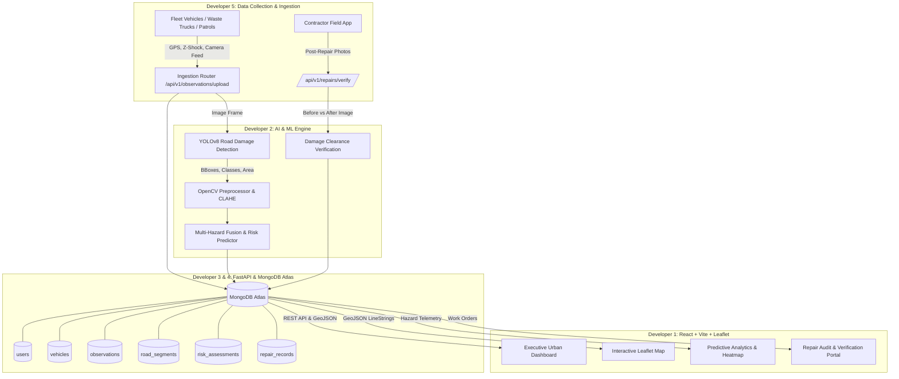

# JanDrishti – System Architecture & Multi-Hazard Fusion Pipeline

JanDrishti is an AI-based Predictive Urban Infrastructure Intelligence platform designed to automate road damage identification, quantify structural risk via multi-hazard telemetry fusion, and provide closed-loop repair verification for municipal authorities.

---

## 1. High-Level Architecture Diagram



---

## 2. End-to-End Functional Pipeline

```
1. Vehicle Data Collection (Dev 5)
   - Vehicle captures HD image + GPS coords + Accelerometer Z-axis shock.
   ↓
2. AI Road Damage Detection (Dev 2)
   - YOLO classifies damage: Pothole (D00), Alligator Cracking (D10), Longitudinal Cracks (D20), Transverse Cracks (D40).
   - OpenCV calculates bounding box area and relative severity.
   ↓
3. GPS Location & Road Snapping (Dev 4)
   - GPS point matched to nearest road segment in MongoDB using $near or geospatial bounding.
   ↓
4. MongoDB Atlas Storage (Dev 4)
   - Observations recorded in `observations` collection.
   ↓
5. Multi-Hazard Fusion (Dev 2 & 3)
   - Combines:
     (a) Damage severity score (pothole depth, surface area)
     (b) Accelerometer vibration magnitude (Z-shock)
     (c) Environmental vulnerability (monsoon rain runoff index)
     (d) Heavy axle traffic volume
   ↓
6. Infrastructure Health Score (IHS) & Risk Prediction (Dev 2 & 3)
   - Generates IHS (0-100 scale: 100=Pristine, 0=Dangerous).
   - Calculates 30-day failure probability (0.0 to 1.0).
   ↓
7. Municipal Dashboard (Dev 1)
   - Visualizes city health on Leaflet map:
     * Green (>75): Good Condition
     * Amber (50-75): Fair / Monitor
     * Red (<50): Critical / Immediate Resurfacing
   ↓
8. Repair Verification (Dev 5 & 1)
   - Municipal work order issued.
   - Contractor submits post-repair photo.
   - AI verifies pothole is filled and smooth; status transitions to `verified_closed`.
```

---

## 3. Decoupling & Independent Execution Guarantees

To ensure all 5 developers can work without waiting on each other:
1. **Mock Fallback Layer:** Both frontend and backend have built-in mock services matching `API_CONTRACT.md`.
2. **AI Engine Standalone Runner:** AI module can run on arbitrary local images and print JSON predictions without needing FastAPI or MongoDB.
3. **Database Seed Script:** A standalone script provides pre-populated Bangalore/Urban road segments with realistic GeoJSON geometries.
